<p align="center">
  
</p>
<h1 align="center">
  
  Hey There, I'm Durga Vara Prasad!
</h1>


<--! <p align="center">
  
</p> -->

<p align="center">
  <!-- Followers -->
  
  
  <!-- Total Stars -->
  
</p>

<p align="center">
  
</p>

<div align="center">
  
</div>
<!-- <h3 align="left"><span style="color:#58A6FF;">⚡ SYSTEM PROFILE — DVP</span></h3>

```yaml
identity:
  name: "Durga Vara Prasad"
  role: "Full Stack Developer & AI Engineer"
  mindset: "Think. Build. Break. Improve. Repeat."

interests:
  - Building products from scratch
  - Experimenting with AI and LLMs
  - Exploring new technologies
  - Turning crazy ideas into real applications

current_status:
  learning: ["Java", "Spring Boot", "DSA", "Cloud"]
  exploring: ["Generative AI", "Agentic AI"]
  philosophy: "Clean code. Creative thinking. No limits."

fun_fact: "I sometimes fix bugs that I accidentally introduced."
availability: "Open to interesting ideas and collaborations."
```

**MISSION:** Build things that solve real problems, create meaningful experiences, and occasionally make developers wonder, "How did this even work?"  -->

<div align="center">
  
</div>

<h3 align="left"><span style="color:#58A6FF;">📈 Activity Pulse & Contribution Arcade</span></h3>

<!-- GitHub Streak Stats + Top Languages -->
<table align="center">
  <tr>
    <td align="center" width="50%">
      
    </td>
    <td align="center" width="50%">
      
    </td>
  </tr>
</table>
<!-- <p align="center">
  
</p> -->
<p align="center">
  <i>Leveling up one commit at a time 🚀</i>
</p>

<p align="center">
  
</p>

<div align="center">
  
</div>

<h3 align="left"><span style="color:#FF7B72;">🛠️ Technical Arsenal</span></h3>

```json
{
  "tech_stack": {
    "languages": [
      "Java", "Python", "JavaScript", "TypeScript", "PHP", "Dart"
    ],
    "frontend": [
      "React", "TypeScript", "JavaScript", "Vite", "Tailwind CSS", "Zustand", "Framer Motion", "Shadcn UI"
    ],
    "backend": [
      "Node.js", "Express.js", "FastAPI", "Flask", "JWT", "PHP", "REST APIs", "Server Architecture"
    ],
    "databases": [
      "MySQL", "MongoDB", "PostgreSQL", "Redis", "Firebase", "Supabase"
    ],
    "cloud_tools_and_devops": [
      "Vercel", "CI/CD Workflows", "Netlify", "Git", "GitHub", "npm", "VS Code"
    ],
    "AI & Machine Learning": [
      "Large Language Models", "Prompt Engineering", "AI Integration", "Voice Recognition", "Document Intelligence", "Predictive Analytics"
    ],
    "Development Tools": [
      "Git", "GitHub", "Postman", "VS Code"
    ],
    "Flutter": [
      "Mobile"
    ],
    "Specialized Integrations": [
      "Voice-to-Text Processing", "Real-Time PDF Analysis", "Email Automation", "Multi-Language Support","Real-Time Collaboration"
    ]
  }
}
```
<div align="center">
  
</div>

<h3 align="left"><span style="color:#79C0FF;">📫 Let's Connect</span></h3>
<div align="center">
  <a href="https://www.linkedin.com/in/durga-vara-prasad-pappuri-1797701b6/">
    
  </a>
  <a href="mailto:durgavaraprasad2003@gmail.com">
    
  </a>
  <a href="https://vara-portfolio.vercel.app">
    
  </a>
</div>

